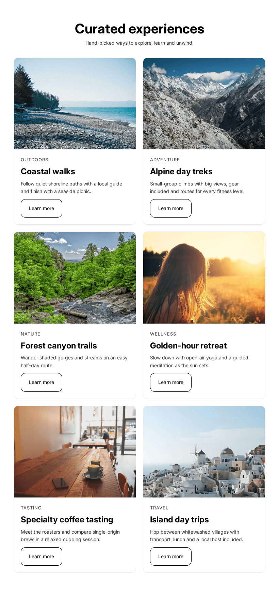
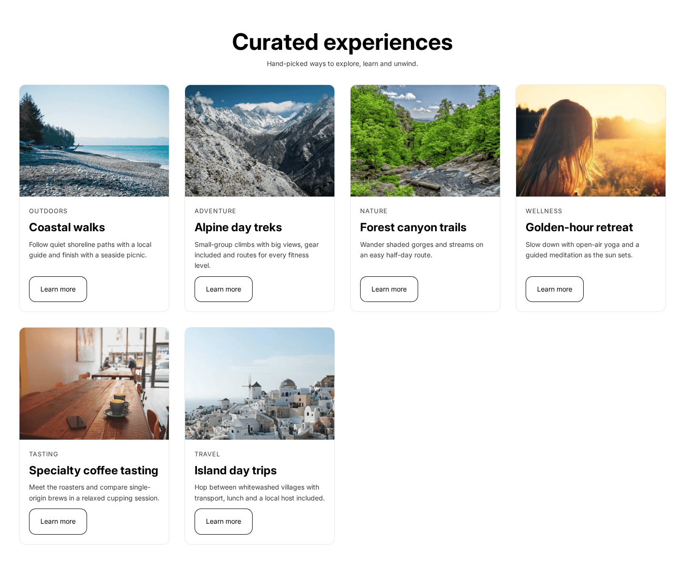

# Experience Cards: a merchant-configurable Shopify section

A reusable homepage section for Shopify's **Horizon** theme. Merchants add up to **six "experience cards"** and control all text, images, links, colors and layout from the **Theme Editor**, with no code.

Built with plain Liquid and scoped CSS. **No JavaScript.**

| Tablet (2 columns) | Mobile (1 column) |
| --- | --- |
|  |  |

## What's in this repo

| File | Purpose |
| --- | --- |
| [`sections/experience-cards.liquid`](sections/experience-cards.liquid) | The section: heading area, responsive grid, section settings, presets and the scoped stylesheet. |
| [`blocks/_experience-card.liquid`](blocks/_experience-card.liquid) | The card, a theme block with its own settings and scoped stylesheet. |
| [`examples/homepage-section.json`](examples/homepage-section.json) | The demo content: the section entry (six cards) as it appears in a homepage template. |
| [`docs/screenshots/`](docs/screenshots) | Rendered captures at desktop, tablet and mobile widths. |

Horizon itself is **not** included (see [Credits](#credits-and-licensing)). The two Liquid files are the whole component.

## What a merchant can configure

Everything below is editable in the Theme Editor. There are no spacing or padding settings, by design: spacing comes from the theme's own tokens so the section always matches its neighbors.

**Section**

| Group | Settings |
| --- | --- |
| Heading | Heading, subheading, heading alignment (left or center) |
| Layout | Cards per row on desktop (2, 3 or 4), cards per row on mobile (1 or 2), image shape (wide, landscape, square, portrait) |
| Colors | Background, heading color, text color |

**Each card** (up to six, added, removed and reordered by drag and drop)

| Group | Settings |
| --- | --- |
| Content | Image, eyebrow text, heading, description |
| Link | Link, button label, button style (primary, secondary, link), open in new tab |
| Colors | Card background, card text |

The section ships with a three-card preset, so it looks sensible the moment it's added. The demo homepage in the screenshots uses six cards. The 4-column option:

## Code walkthrough

**Section schema** ([`sections/experience-cards.liquid`](sections/experience-cards.liquid))
- `"max_blocks": 6` and `"blocks": [{ "type": "_experience-card" }]` cap the cards at six and accept only this block type.
- `disabled_on` keeps the section out of the header and footer groups.
- Settings are `select` and `color` inputs. The Liquid turns them into CSS custom properties on the section's root element (`--experience-cards-columns-desktop`, `--experience-cards-image-ratio` and so on), so the stylesheet itself stays static.
- A background color goes through Horizon's own `contrast-override` snippet, so text stays readable whatever the merchant picks.

**Card block** ([`blocks/_experience-card.liquid`](blocks/_experience-card.liquid))
- A theme block, not inline section settings. The section owns layout, each card owns its content, and Horizon's editor handles adding and ordering.
- Each card is a semantic `<article>` and carries `{{ block.shopify_attributes }}` so the editor can select it.
- When a link is set, one anchor's `::after` covers the whole card: one tab stop per card, and the whole card is clickable. With no button label, the heading becomes the link.
- Merchant text is escaped. Images use `image_tag` with `srcset`, `sizes` and lazy loading, and fall back to Horizon's placeholder when empty.

## Approach

### Responsive
- CSS grid with `minmax(0, 1fr)` columns, so long words and images can't stretch a column.
- Breakpoints reuse Horizon's (750px and 990px): 1 or 2 columns on mobile, always 2 on tablet, 2 to 4 on desktop.
- Images keep a merchant-chosen `aspect-ratio`, so there's no layout shift while they load.
- Cards in a row stretch to equal height and the buttons align along the bottom.

### Code isolation
- Each file owns its CSS in a single `` tag, the theme's convention, so where Shopify's stylesheet subsetting is active the CSS loads only on pages that render the section.
- Class names are namespaced (`experience-cards__*`, `experience-card__*`) and so are the custom properties. The CSS has no global or element selectors, and low-specificity class selectors keep the cascade predictable.
- No JavaScript: nothing to conflict with the theme's own scripts, import map or section re-rendering.

### Protecting existing theme functionality
- The component is **purely additive**: two new files, and no existing Horizon file is edited to make it work, so existing sections, templates and settings behave exactly as before. The only other change on the demo theme is one new section entry in the homepage template, to show it in use.
- It's built on the theme's own design tokens (colors, fonts, radii, gaps) and button classes, so it follows the merchant's global theme settings and matches the rest of the page.
- All work was done on an **unpublished copy** of the theme. The live theme was never touched.
- Checked with Theme Check (no findings in these files), accepted by Shopify on upload, and previewed in a browser at desktop, tablet and mobile widths with no horizontal overflow.
- Accessibility: semantic headings under the section's `h2`, a visible focus outline, `prefers-reduced-motion` respected for the image hover effect, and alt text read from each image's file.

### Known limitations
- Schema labels are plain English rather than Horizon's `t:` translation keys. I chose that so the component doesn't edit Horizon's shared, auto-generated locale files. It means the labels aren't translatable yet.
- The component relies on Horizon's tokens and shared snippets (`contrast-override`, the `.section--page-width` wrapper), so it targets Horizon and would need adapting for other themes.
- Card images always lazy-load, and `sizes` is a conservative estimate rather than an exact per-layout value.

## How this was built

Built utilizing Claude (Claude Code). I defined the requirements, made the design and architecture decisions, and reviewed the output.

The [commit history](https://github.com/NiickFenske/shopify-experience-cards/commits/main) shows the progression, one commit per step: the section and block first, then the demo content, then a layout fix found while previewing at tablet width.

## Using it

1. In a Horizon theme (tested on 4.3.0), copy `sections/experience-cards.liquid` into `sections/` and `blocks/_experience-card.liquid` into `blocks/`.
2. Push to a **development or unpublished theme** first, for example `shopify theme push --unpublished`.
3. In the Theme Editor, open the homepage, choose **Add section**, and pick **Experience cards**.
4. To reproduce the demo, paste `examples/homepage-section.json` into the homepage template's `sections` and add its key to `order`. Its images are `shopify://shop_images/...` references to files in the demo store, so choose your own images in the editor.

## Credits and licensing

- **Horizon** is Shopify's theme, and this component is built to work within it. Horizon is released under Shopify's own license, which restricts redistribution of the theme outside Shopify channels. For that reason this repository contains only the new files and none of Horizon's source. Get Horizon from [Shopify/horizon](https://github.com/Shopify/horizon).
- **Demo photos** are from [Picsum Photos](https://picsum.photos), which serves free images from Unsplash, by Paul Jarvis, Go Wild, Jerry Adney, Alexander Shustov, Luke Chesser and Margaret Barley.
